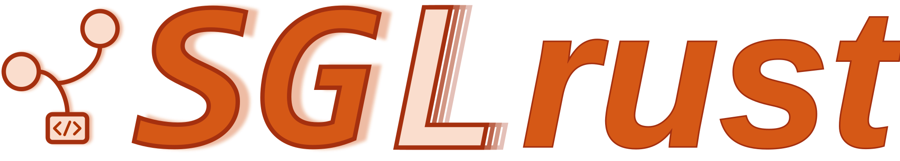
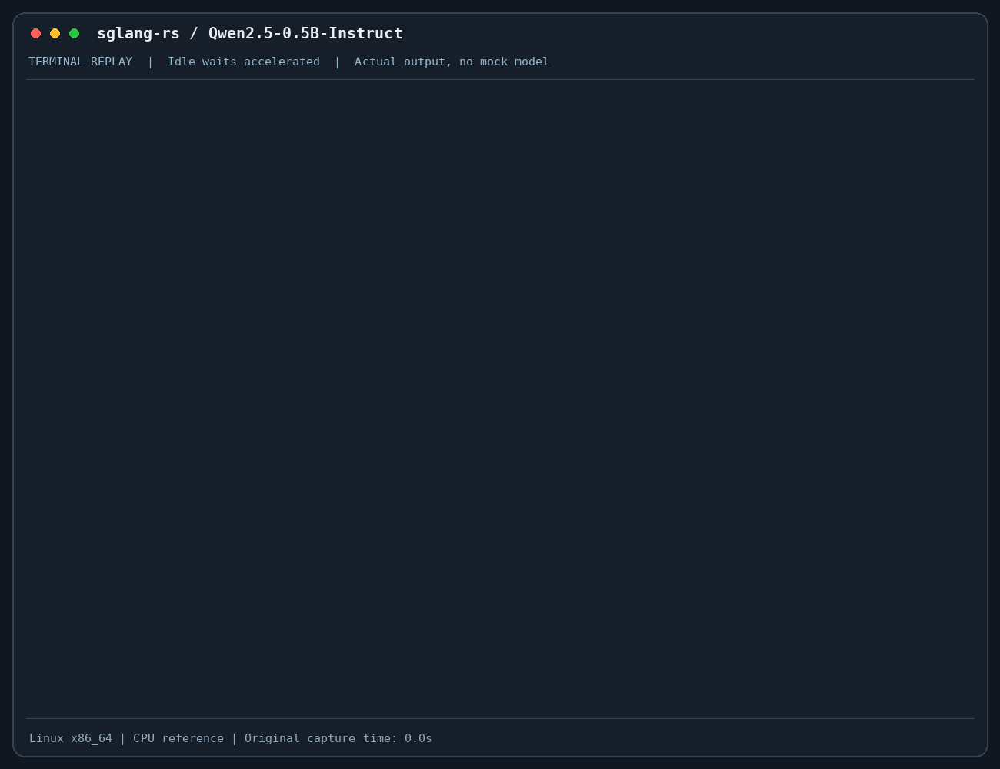

<p align="center">
  
</p>

<p align="center">
  <strong>Rust-native LLM serving with prefill/decode disaggregation.</strong>
</p>

<p align="center">
  <a href="https://github.com/imReese/sglang-rs/actions/workflows/ci.yml"></a>
  <a href="rust-toolchain.toml"></a>
  <a href="LICENSE"></a>
</p>

<p align="center">
  <a href="#demo">Demo</a> &middot;
  <a href="#quick-start">Quick&nbsp;Start</a> &middot;
  <a href="docs/support.md">Models&nbsp;&amp;&nbsp;Backends</a> &middot;
  <a href="docs/disaggregation.md">P/D&nbsp;Guide</a> &middot;
  <a href="docs/validation.md">Validation</a>
</p>

An independent implementation targeting [SGLang](https://github.com/sgl-project/sglang) and `sgl-model-gateway` serving contracts.

## Demo

Full [Qwen3.5-0.8B](https://huggingface.co/Qwen/Qwen3.5-0.8B) on macOS CPU: 18 Gated DeltaNet layers, 6 full-attention layers, and real token streaming.



*Idle waits are shortened; actual timings remain visible. This is CPU reference validation, not a GPU benchmark. [Recording details](docs/validation.md#recorded-cpu-demo).*

## Quick Start

Requires `rustup` and the Hugging Face `hf` CLI. Use an existing local checkpoint to skip the download. The pinned revision matches the demo; weights are about 1.75 GB. The default Rust build needs neither a CUDA SDK nor native Mooncake.

```bash
git clone https://github.com/imReese/sglang-rs.git
cd sglang-rs
cargo build --release --locked --bin sglang-rs

export MODEL_PATH="$HOME/.cache/sglang-rs/Qwen3.5-0.8B"
hf download Qwen/Qwen3.5-0.8B \
  --revision 2fc06364715b967f1860aea9cf38778875588b17 \
  --local-dir "$MODEL_PATH"

./target/release/sglang-rs serve \
  --model-path "$MODEL_PATH" \
  --served-model-name Qwen3.5-0.8B \
  --device cpu \
  --host 127.0.0.1 --port 30000 \
  --max-total-tokens 32768 \
  --max-running-requests 1
```

From another terminal:

```bash
curl --fail http://127.0.0.1:30000/health

curl --fail-with-body --no-buffer \
  http://127.0.0.1:30000/v1/chat/completions \
  -H 'Content-Type: application/json' \
  -d '{
    "model": "Qwen3.5-0.8B",
    "messages": [{"role": "user", "content": "Count from 1 to 5, separated by commas. Output only the numbers."}],
    "temperature": 0,
    "max_tokens": 16,
    "stream": true,
    "chat_template_kwargs": {"enable_thinking": false}
  }'
```

Use `"stream": false` for a single JSON response. CPU execution is an FP32 correctness reference; keep prompts short. This example reserves 32K (32,768) KV token slots, not the model's full context capacity. For a download-free Transformer smoke, run [`./scripts/run_cpu_reference_smoke.sh`](scripts/run_cpu_reference_smoke.sh).

## Capabilities

| Area | Current scope |
| --- | --- |
| Text serving | OpenAI-compatible chat/completions and SSE; native gRPC |
| CPU reference | Dense and hybrid execution; full Qwen3.5-0.8B validated |
| CUDA | BF16 executors and single-node dense TP; hardware acceptance required |
| P/D transfer | Native Mooncake FFI, single rank; network acceptance required |
| Metal / ROCm / MUSA | Not implemented; explicit startup errors |
| NexusKV | Memory descriptor contract only; no store/offload or network executor integration |

Adapters compose shared dense, hybrid, MLA, and MoE components. Model recognition is not a support guarantee: missing execution, dtype, topology, or transfer capabilities fail at startup, without CPU or fake fallback. `--device auto` probes production backends only; CPU requires `--device cpu`.

P/D currently transfers full prompts without prefix reuse. Recurrent-state transfer is not implemented, so Qwen3.5 and Kimi Linear P/D are rejected. See the [support matrix](docs/support.md) and [P/D limits](docs/disaggregation.md#current-limits).

## Documentation

| Guide | Contents |
| --- | --- |
| [Models and backends](docs/support.md) | Adapter coverage, capabilities, runtime architecture, and KV capacity |
| [P/D disaggregation](docs/disaggregation.md) | Mooncake build, restrictions, shutdown, and NexusKV boundaries |
| [Validation](docs/validation.md) | Local checks, numerical oracles, CUDA acceptance, and demo timings |
| [Router](crates/sglang-router/README.md) | HTTP/gRPC routing and control-plane surface |

The workspace contains [`sglang-srt`](crates/sglang-srt) (runtime), [`sglang-kernel`](crates/sglang-kernel) (kernels and device bindings), and [`sglang-router`](crates/sglang-router) (routing), with shared RPC definitions under [`proto`](proto).

## License

[MIT](LICENSE). Third-party [artwork](docs/assets/README.md), models, and dependencies retain their own licenses.
